# ⚡ E-Commerce Streaming Data Pipeline

An end-to-end e-commerce streaming pipeline built with **Azure Event Hubs, Databricks, Spark Structured Streaming, Delta Lake, ADLS Gen2 and Power BI**.

The project simulates e-commerce orders, streams them through Azure Event Hubs, processes them using a **Bronze → Silver → Gold** architecture and exposes aggregated data through Databricks SQL Warehouse for business reporting.

---

## 🏗️ Architecture

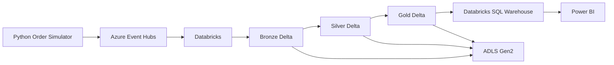

### End-to-End Flow

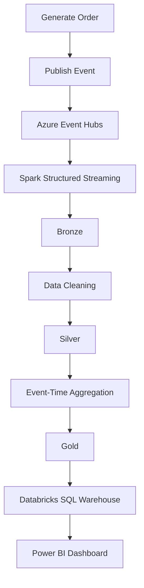

---

# 📊 Final Dashboard

The Gold layer is exposed through Databricks SQL Warehouse and used as the analytical source for Power BI.

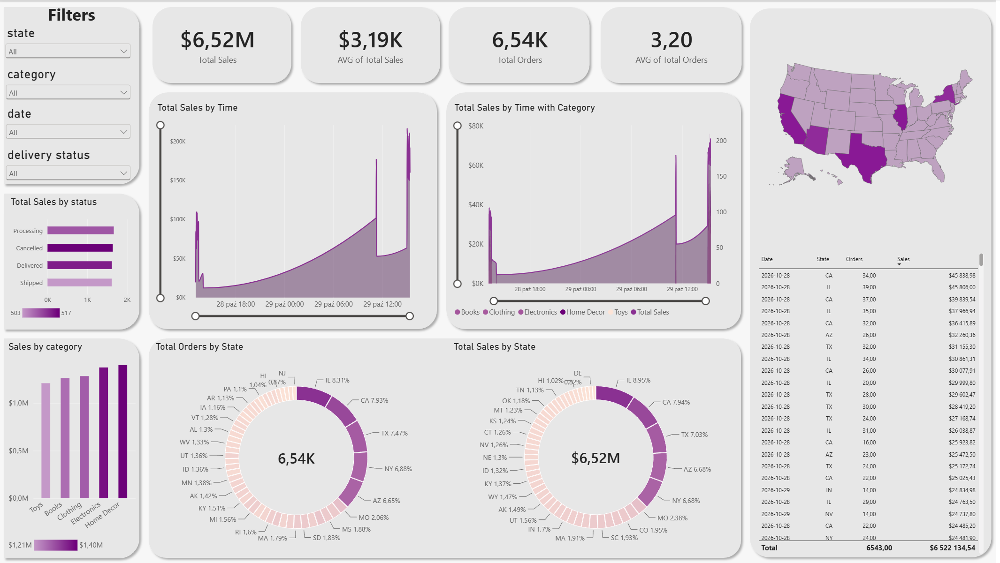

The dashboard provides an analytical view of the generated e-commerce data, including sales, items, states, categories and delivery status.

---

# 🔗 Databricks Job Lineage

The Databricks workflow connects the Bronze, Silver and Gold processing stages.

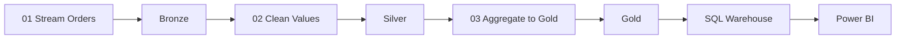

Example lineage from the completed Databricks job:

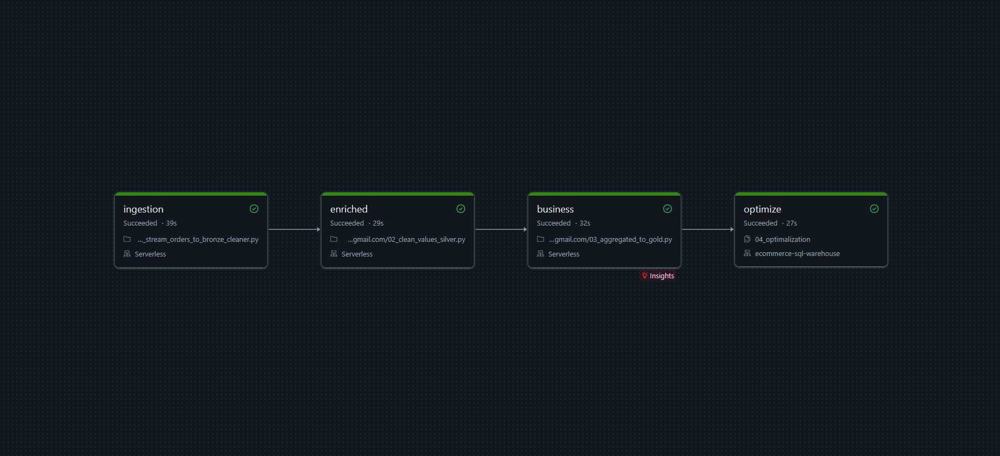

---

# 🔄 Pipeline

## 1. Order Generation

The pipeline starts with a Python simulator that generates synthetic e-commerce orders.

Each event contains:

| Field | Description |
|---|---|
| `order_id` | Unique order identifier |
| `timestamp` | Event timestamp |
| `customer_id` | Customer identifier |
| `product_id` | Product identifier |
| `category` | Product category |
| `price` | Product price |
| `quantity` | Quantity ordered |
| `total_amount` | Order value |
| `city` | Customer city |
| `state` | Customer state |
| `country` | Customer country |
| `latitude` | Customer latitude |
| `longitude` | Customer longitude |
| `delivery_status` | Processing / Shipped / Delivered / Cancelled |

The simulator publishes the events to Azure Event Hubs using its Kafka-compatible endpoint.

---

# 2. Azure Event Hubs

Azure Event Hubs is used as the event ingestion layer between the Python producer and Databricks.

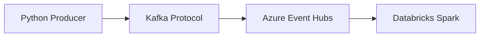

Databricks consumes events from the `ecommerce-orders` Event Hub using Spark's Kafka source.

---

# 🥉 3. Bronze Layer

Notebook:

```text
databricks_notebooks/01_stream_orders_to_bronze.py
```

The Bronze layer stores incoming events in Delta format with minimal transformation.

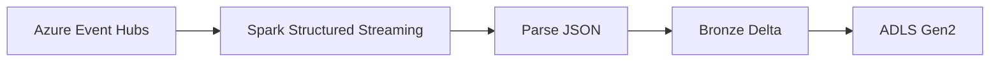

The incoming JSON payload is parsed using an explicit Spark schema before being written to the Bronze layer.

The Bronze layer acts as the first persistent stage of the pipeline.

---

# 🥈 4. Silver Layer

Notebook:

```text
databricks_notebooks/02_clean_values_silver.py
```

The Silver layer cleans and validates the Bronze data before analytical processing.

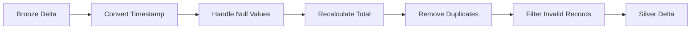

Main transformations:

- Convert `timestamp` from string to Spark timestamp
- Replace missing `price` values
- Replace missing `quantity` values
- Recalculate `total_amount`
- Remove duplicate `order_id` values
- Keep only records where `country = USA`
- Remove records without a `state`

The result is a cleaner dataset ready for aggregation.

---

# 🥇 5. Gold Layer

Notebook:

```text
databricks_notebooks/03_aggregated_to_gold.py
```

The Gold layer transforms individual orders into aggregated, analytics-ready data.

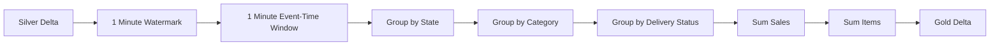

---

## Event-Time Windows

The Gold aggregation uses the event's `timestamp` instead of simply grouping records by processing time.

The pipeline uses:

- **1-minute event-time windows**
- **1-minute watermark**
- `state`
- `category`
- `delivery_status`

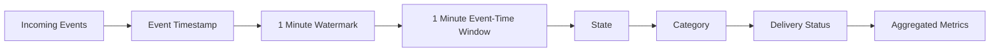

### Gold grain

Each Gold record represents:

**1-minute event-time window × state × category × delivery status**

The pipeline calculates:

- `total_sales` = sum of `total_amount`
- `total_items` = sum of `quantity`

### Gold schema

| Column | Description |
|---|---|
| `window_start` | Start of the event-time window |
| `window_end` | End of the event-time window |
| `state` | US state |
| `category` | Product category |
| `delivery_status` | Delivery status |
| `total_sales` | Total sales |
| `total_items` | Total quantity sold |

Example:

```text
window_start        window_end          state  category       delivery_status  total_sales  total_items
2026-10-28 13:22    2026-10-28 13:23    CA     Electronics    Delivered         2450.50      4
```

---

# ⏱️ Streaming Trigger

The notebooks use:

```python
.trigger(availableNow=True)
```

`availableNow=True` processes the data currently available and then terminates the query.

This means the project uses **bounded streaming runs** rather than an always-running streaming job.

New events can be processed by starting the pipeline again.

---

# 📈 6. Power BI

The Gold data is exposed through **Databricks SQL Warehouse** and consumed by Power BI.

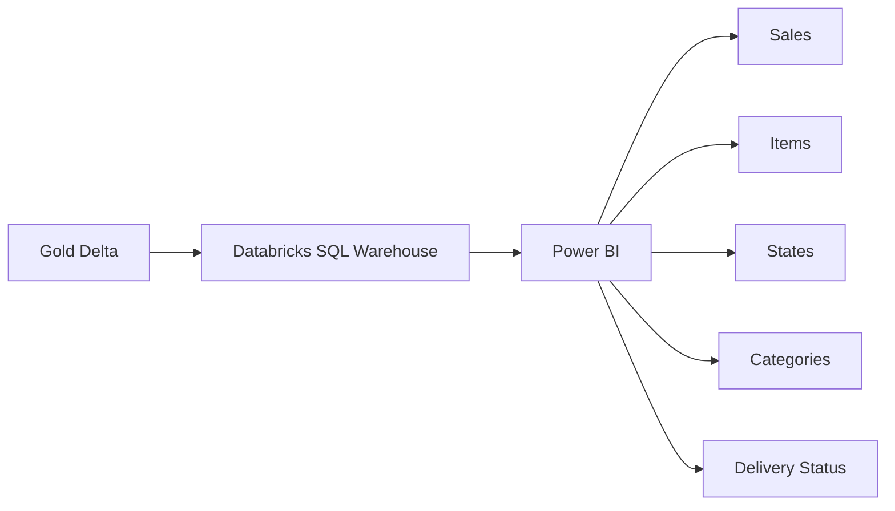

The final report can be used to analyse:

- total sales
- total items sold
- sales by state
- sales by category
- delivery status
- sales over time

---

# 🧰 Tech Stack

| Technology | Purpose |
|---|---|
| **Python** | Synthetic order generation |
| **Azure Event Hubs** | Event ingestion |
| **Apache Spark** | Stream processing |
| **Databricks** | Data engineering platform |
| **Delta Lake** | Data storage and processing |
| **ADLS Gen2** | Cloud storage |
| **Databricks SQL Warehouse** | SQL analytics |
| **Power BI** | Business intelligence |

---

# 📁 Project Structure

```text
ecom-stream-pipeline/
│
├── databricks_notebooks/
│   ├── 01_stream_orders_to_bronze.py
│   ├── 02_clean_values_silver.py
│   ├── 03_aggregated_to_gold.py
│   └── databricks_job_lineage.png
│
├── powerbi/
│   └── dashboard-preview.png
│
├── simulator/
│   └── generate_orders.py
│
└── README.md
```

---

# 🚀 Running the Pipeline

### 1. Configure Azure Event Hubs

Create the Event Hub:

```text
ecommerce-orders
```

Configure the required Databricks credentials for accessing Event Hubs.

### 2. Start the simulator

Run:

```text
simulator/generate_orders.py
```

The simulator starts publishing synthetic orders.

### 3. Run the Databricks pipeline

Execute the notebooks in order:

```text
01_stream_orders_to_bronze.py
        ↓
02_clean_values_silver.py
        ↓
03_aggregated_to_gold.py
```

### 4. Connect Power BI

Connect Power BI to the Databricks SQL Warehouse and use the Gold dataset for reporting.

---

# 🎯 Key Concepts

This project demonstrates:

- Event-driven data ingestion
- Azure Event Hubs
- Kafka-compatible ingestion
- Spark Structured Streaming
- Event-time processing
- Watermarks
- Window aggregations
- Medallion Architecture
- Delta Lake
- ADLS Gen2
- Databricks SQL Warehouse
- Power BI

---

# 👨‍💻 Author

**Michał Sitarz**

Data / Analytics Engineering enthusiast focused on:

**SQL • Python • Databricks • Azure • Spark • dbt • Power BI**

[GitHub](https://github.com/Gezzus1703)
